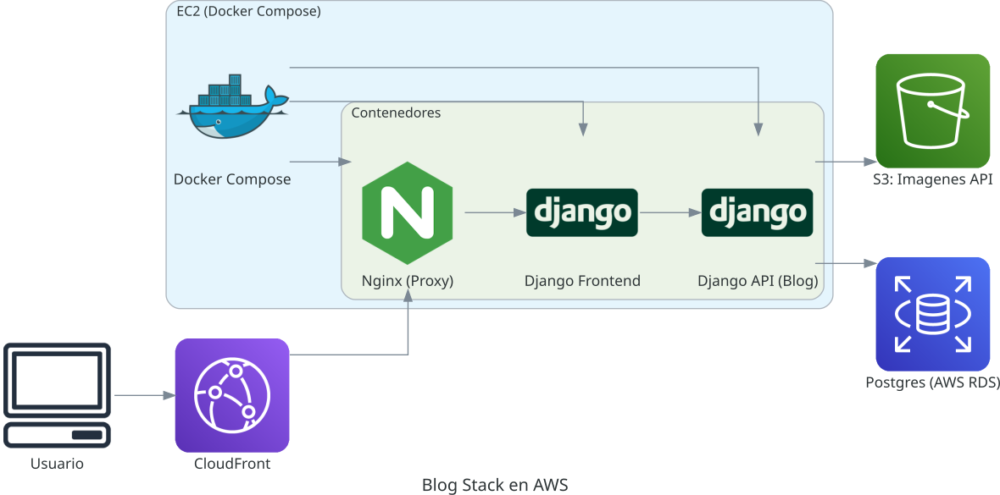

# nginx-flask-prod

Stack Docker Compose que levanta todos los sitios en producción —
Python + Nginx + Docker, sin vendor-lock y fácil de clonar.



> **Nota**: la antigua carpeta `php/` quedó fuera del repositorio (solo vive en mi server).

---

## Servicios

| Servicio | Tech | Rol | Carpeta |
|----------|------|-----|---------|
| **nginx-proxy** | Nginx (latest) | Reverse-proxy HTTPS + estáticos | [`/nginx`](nginx) |
| **django-api** | Django 4 + DRF | Backend REST + `/admin` del blog | [`/django-api`](django-api) |
| **blog-front** | Django 4 + templates | Frontend público del blog | [`/django_blog_front`](django_blog_front) |
| **flask** | Flask 3 | Landing / página en construcción | [`/app`](app) |
| **certbot** | certbot/certbot | Renovación de certificados Let's Encrypt | — |

Puertos expuestos en producción:

| Puerto | Servicio | URL |
|--------|----------|-----|
| 80 / 443 | nginx-proxy (HTTP → HTTPS) | https://estebanmartins.com.ar |
| 8000 | django-api | http://localhost:8000/admin/ |
| 8500 | blog-front | http://localhost:8500 |

---

## Levantar en local (desarrollo)

Cada servicio necesita su propio archivo `.env`. Copiar desde los ejemplos y completar:

```bash
cp app/.env.example         app/.env
cp django-api/.env.example  django-api/.env
cp django_blog_front/.env.example django_blog_front/.env
```

Luego levantar con el override de desarrollo:

```bash
git clone https://github.com/hokuto06/nginx-flask-prod.git
cd nginx-flask-prod
docker compose -f docker-compose.yml -f docker-compose-override.yml up -d --build
```

El `docker-compose-override.yml` reemplaza Gunicorn por `runserver` y mapea
puertos individuales de Nginx (8080–8084) para desarrollo local.

---

## Desplegar en producción

El deploy a EC2 se dispara automáticamente en cada push a `main` via
`.github/workflows/deploy.yml`. Por defecto solo hace `git pull`.
El comportamiento exacto se controla con **etiquetas en el mensaje del commit**:

| Etiqueta | Qué ejecuta en EC2 |
|----------|--------------------|
| _(ninguna)_ | `git pull` — sin tocar contenedores |
| `[restart]` | `git pull` → `docker compose down` → `docker compose up -d` |
| `[rebuild]` | `git pull` → `docker compose up -d --build` (reconstruye imágenes) |

Ejemplos de uso:

```bash
git commit -m "Actualizar config Nginx [restart]"
git commit -m "Cambiar dependencias Python [rebuild]"
git commit -m "Corregir typo en README"   # solo git pull, sin tocar contenedores
```

> Las etiquetas son sensibles a mayúsculas y deben ir entre corchetes exactamente
> como aparecen arriba. Si se incluyen ambas, `[rebuild]` tiene precedencia.

### Secrets requeridos en GitHub

Configurar en _Settings → Secrets → Actions_:

| Secret | Descripción |
|--------|-------------|
| `SSH_PRIVATE_KEY` | Clave privada ed25519 con acceso al servidor |
| `EC2_HOST` | IP o hostname del servidor |
| `EC2_USER` | Usuario SSH (generalmente `ubuntu`) |

---

## Variables de entorno

Cada servicio lee su configuración de un `.env` local (gitignoreado).
Los archivos `.env.example` documentan todas las variables requeridas.

| Variable | Servicio | Descripción |
|----------|----------|-------------|
| `SECRET_KEY` | django-api, blog-front | Django secret key — ver `.env.example` para comando de generación |
| `DB_USER` / `DB_PASSWORD` / `DB_HOST` / `DB_PORT` / `DB_NAME` | django-api | Conexión PostgreSQL |
| `AWS_ACCESS_KEY_ID` / `AWS_SECRET_ACCESS_KEY` | django-api | Credenciales S3 para media |
| `AWS_STORAGE_BUCKET_NAME` / `AWS_S3_REGION_NAME` | django-api | Bucket S3 y región |
| `FLASK_SECRET_KEY` | flask | Clave de sesión Flask |

---

## Renovación de certificados (Let's Encrypt)

El servicio `certbot` corre en modo `sleep infinity` y comparte el volumen
`./letsencrypt` con Nginx. Para renovar:

```bash
docker compose run --rm certbot renew
docker compose exec nginx nginx -s reload
```

---

## Estáticos Django → Nginx

Ver [`docs/static-files-setup.md`](docs/static-files-setup.md) para el flujo
completo de `collectstatic` + volumen compartido + Nginx.

---

## Roadmap

- [ ] Migrar landing Flask → React
- [ ] Pipeline de tests (pytest + coverage)
- [ ] CDN S3 para media via CloudFront + WAF

---

Esteban Martins — [estebanmartins.com.ar](https://estebanmartins.com.ar)
